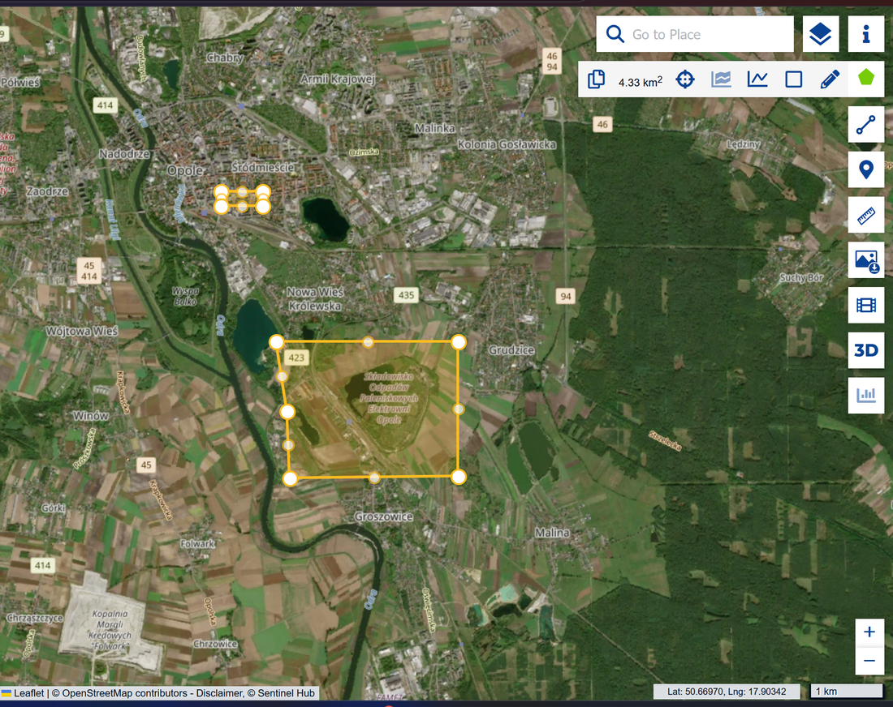
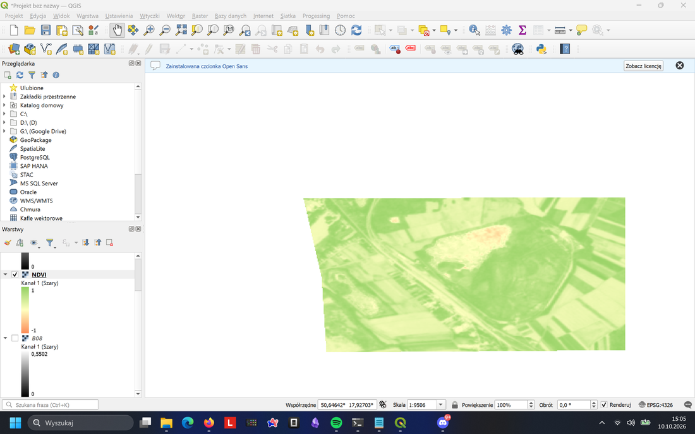

# Analiza NDVI – Opole

**Cel:** wyznaczenie wskaźnika NDVI dla okolic składowiska odpadów paleniskowych Elektrowni Opole na podstawie danych satelitarnych Sentinel-2 z **28.09.2026**.

## 1. Wybór obszaru i danych

W serwisie [Copernicus Browser](https://browser.dataspace.copernicus.eu/) wybrano obszar wokół składowiska odpadów w Opolu. Ustawiono kolekcję **Sentinel-2 L2A** i scenę z 28.09.2026, wybierając obraz o niewielkim zachmurzeniu.

## 2. Pobranie pasm satelitarnych

W opcji **Download → Analytical** pobrano rastry w formacie **TIFF (32-bit float)**, z ustawieniem rozdzielczości **High**. Wybrano dwa pasma potrzebne do obliczenia indeksu: [B04 – czerwone (RED)](<2026-09-28-00_00_2026-09-28-23_59_Sentinel-2_L2A_B04_(Raw).tiff>) oraz [B08 – bliska podczerwień (NIR)](<2026-09-28-00_00_2026-09-28-23_59_Sentinel-2_L2A_B08_(Raw).tiff>).

## 3. Import do QGIS

Oba pliki TIFF wczytano do programu **QGIS** jako warstwy rastrowe. Dla czytelności zmieniono ich nazwy na `B04` i `B08`.

## 4. Obliczenie NDVI

W **Raster → Kalkulator rastra** zastosowano wzór `NDVI = (NIR - RED) / (NIR + RED)`. Wprowadzono wyrażenie `("B08@1" - "B04@1") / ("B08@1" + "B04@1")`, a wynik zapisano do pliku [wynik.tif](wynik.tif).

## 5. Wizualizacja i interpretacja

Dla rastra wynikowego ustawiono **Jednokanałowy pseudokolor**, paletę **RdYlGn** oraz zakres wartości od **-1 do 1**. Odcienie zieleni oznaczają wyższe wartości NDVI i większą aktywność roślinności, a żółte i czerwone niższe wartości.

## 6. Zapis projektu

Projekt QGIS zapisano w pliku [wynikk.qgz](wynikk.qgz), a obliczoną warstwę w [wynik.tif](wynik.tif). Do ponownego otwarcia projektu należy zachować pliki `wynikk.qgz`, `wynik.tif`, B04 i B08 **w tym samym katalogu**.
