# Sprawozdanie – GeoPandas i Rasterio

## Część A – GeoPandas

### A2. Wczytanie danych

Wczytałem `pm25_sensors.csv` pandasem: 145 wierszy, 5 kolumn. W danych jest 5 duplikatów, 3 braki w `lat`, 4 w `lon` i wartości -999 w `pm25`. Minimum `lat` wynosi 17,87, bo w trzech wierszach lat i lon są zamienione.

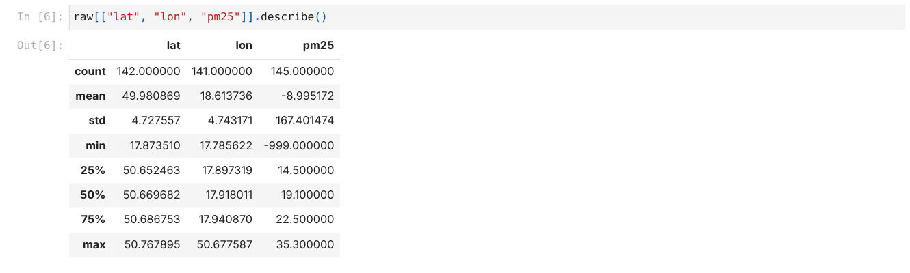

### A3. Czyszczenie

Usunąłem duplikaty i wiersze bez współrzędnych, naprawiłem zamienione lat/lon i usunąłem -999. Zostało 130 wierszy.

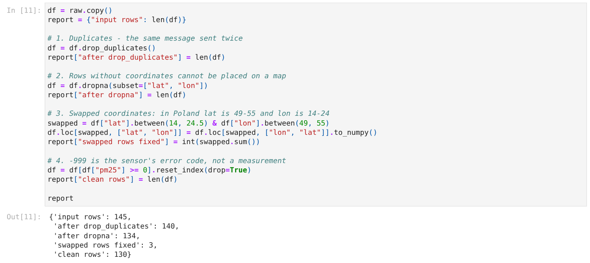

### A4. GeoDataFrame

Z tabeli zrobiłem punkty w EPSG:4326. Wszystkie leżą w Opolu.

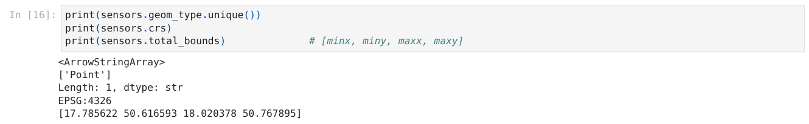

### A5. Układy współrzędnych

W EPSG:2180 odległość między dwoma pierwszymi czujnikami wychodzi 4906 m. Na odcinku Gdańsk–Zakopane EPSG:2180 myli się o -0,07%, a EPSG:3857 o +62%.

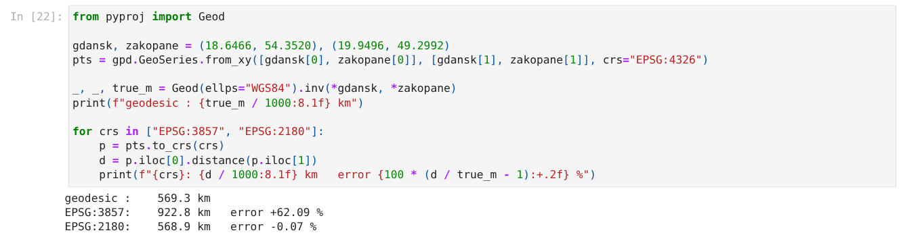

### A6. Dzielnice

Miasto ma 29 dzielnic i 148,8 km² powierzchni. Największe są Czarnowąsy (14,1 km²), najmniejsze Borki (0,66 km²).

### A7. Złączenie przestrzenne

Wszystkie 130 czujników zostało przypisanych do dzielnic, 3 dzielnice nie mają żadnego czujnika. Wśród dzielnic z co najmniej 3 czujnikami najgorsze powietrze mają Stare Miasto (29,6 µg/m³), Śródmieście (26,8) i Zaodrze (22,5).

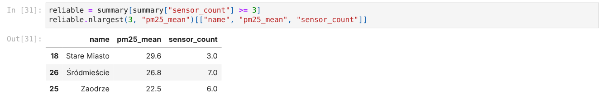
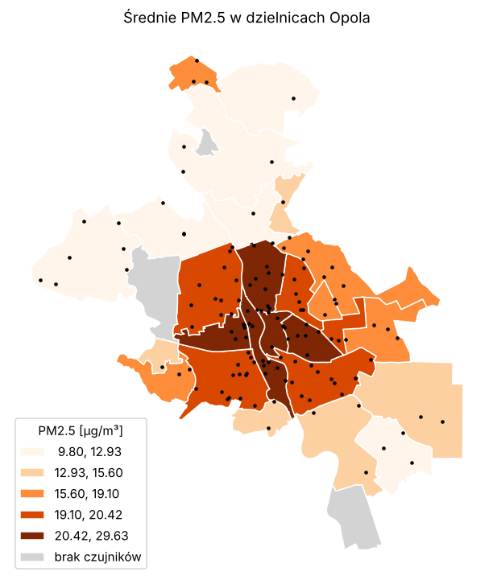

### A8. Bufory wokół szkół

11 z 19 szkół ma czujnik w promieniu 500 m. Średnie PM2.5 przy szkołach wynosi 22,3 µg/m³, a bufory pokrywają 9,5% miasta.

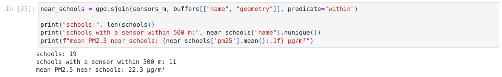

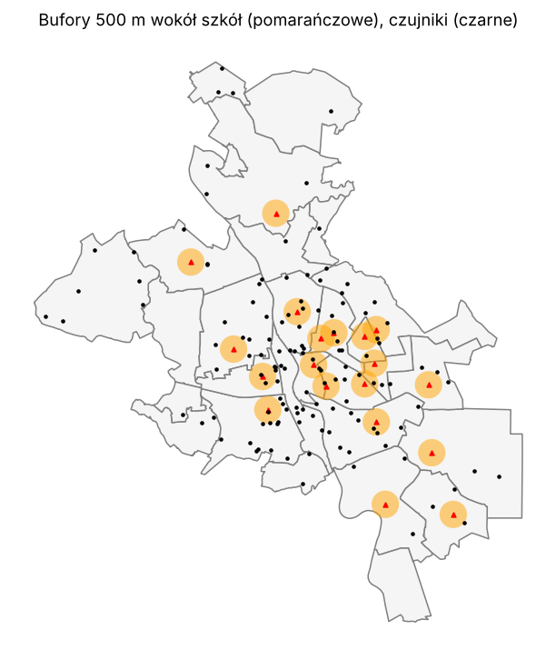

### A9. Zapis

Wyniki zapisałem do `pm25.gpkg` (dwie warstwy) i `pm25_districts.geojson`.

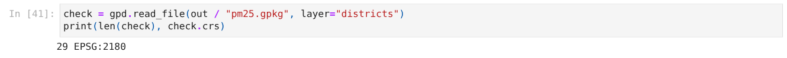

## Część B Rasterio

### B2. Metadane

Rastry mają 1995 × 1426 px, typ float32, układ EPSG:4326 i brak nodata. Piksel ma ok. 6,3 × 6,3 m.

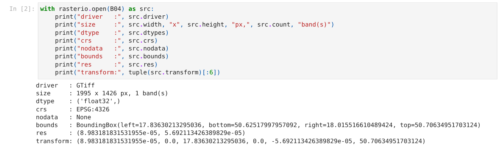
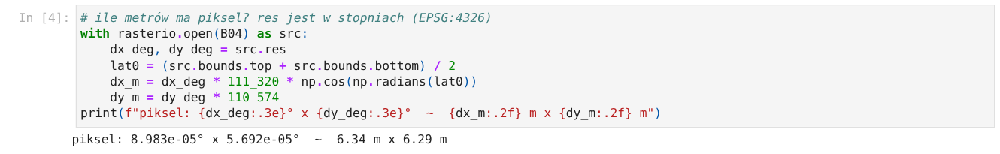

### B3. Piksel ↔ współrzędne

Rynek wypada w pikselu (671, 960), NDVI ma tam wartość 0,07.

### B4. Pasma i histogramy

### B5. Reprojekcja

Oba pasma przeliczyłem na EPSG:2180 z pikselem 10 m.

### B6. NDVI

Średnie NDVI dla całej sceny wynosi 0,49.

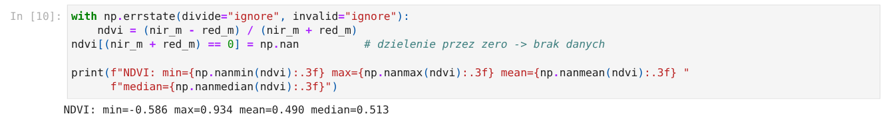
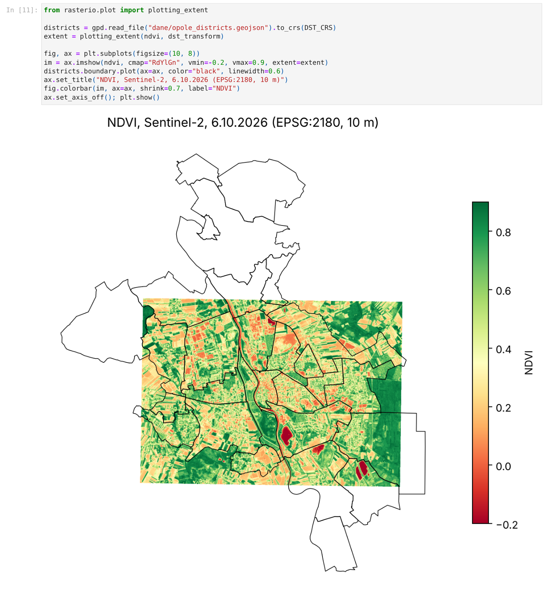

### B7. Klasyfikacja

### B8. NDVI w dzielnicach

Zdjęcie nie obejmuje północy miasta, więc w rankingu są tylko dzielnice pokryte w co najmniej 90%. Najwięcej zieleni ma Nadodrze (0,66), najmniej Stare Miasto (0,36).

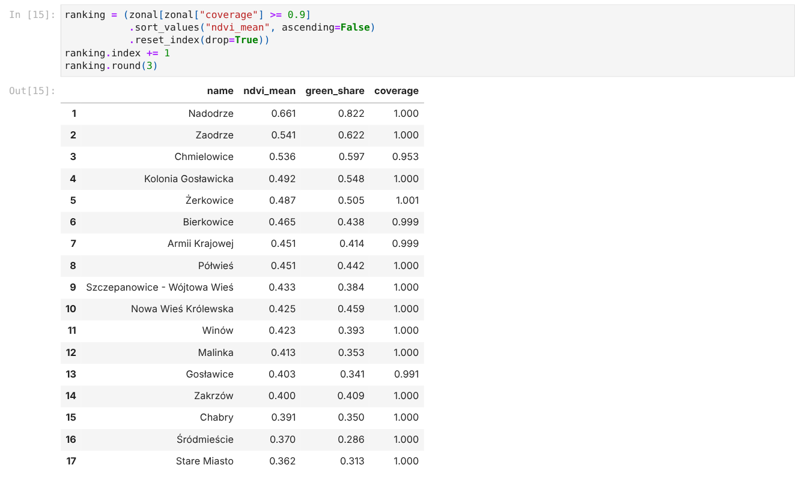
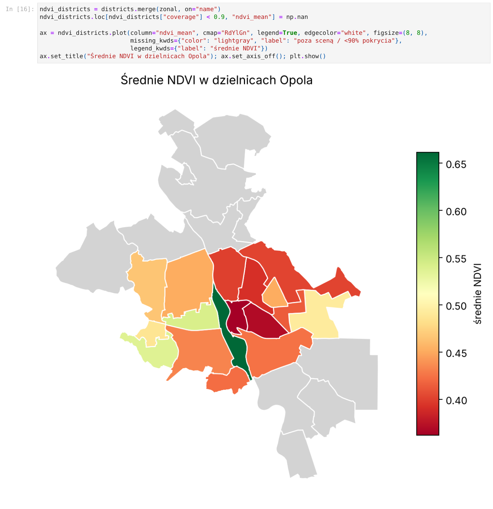

### B9. Zapis

## Wnioski

Najgorsze powietrze i najmniej zieleni są w centrum (Stare Miasto, Śródmieście), a najwięcej zieleni ma Nadodrze. Odległości, powierzchnie i bufory trzeba liczyć w układzie metrycznym (EPSG:2180), a dane przed analizą trzeba dokładnie przejrzeć i oczyścić.
