# Sprawozdanie – zad_2: GeoPandas i Rasterio

Poniżej opisałem po kolei, co trzeba zrobić, żeby wykonać zadanie, a pod każdym krokiem wkleiłem wynik z mojego notatnika. Cały kod jest w plikach `lab_geopandas.ipynb` (część A) i `lab_rasterio.ipynb` (część B).

## Krok 0. Przygotowanie

1. Utwórz katalog `lab_geo/`, a w nim podkatalog `dane/`.
2. Do `dane/` skopiuj pliki od prowadzącego: `pm25_sensors.csv`, `opole_districts.geojson`, `opole_schools.geojson`, `S2_L2A_2026-10-06_B04.tiff`, `S2_L2A_2026-10-06_B08.tiff`.
3. Utwórz środowisko i zainstaluj biblioteki:

```
python -m venv .venv
source .venv/bin/activate
pip install -r requirements.txt
jupyter lab
```

4. W pierwszej komórce notatnika sprawdź wersje bibliotek. GeoPandas powinien mieć wersję co najmniej 1.0.


## Część A – GeoPandas

### Krok A1. GeoDataFrame od zera

Utwórz punkt i kwadrat w Shapely, a potem złóż z nich GeoDataFrame z `crs="EPSG:4326"`. Sprawdź, czy CRS to EPSG:4326, a typy geometrii to Point i Polygon.


### Krok A2. Wczytanie danych

Wczytaj CSV przez `pd.read_csv(..., parse_dates=["measured_at"])`, a potem obejrzyj dane: `describe()`, `isna().sum()`, `duplicated().sum()`. Powinno wyjść 145 wierszy, minimum `pm25` równe -999, minimum `lat` ok. 17,87, braki 3 w `lat` i 4 w `lon` oraz 5 duplikatów. Wartość `lat` ≈ 17,9 to długość geograficzna Opola: w trzech wierszach lat i lon są zamienione.

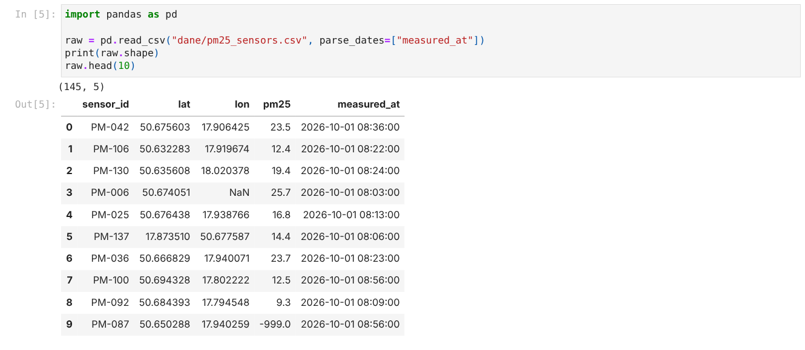


### Krok A3. Czyszczenie

Po kolei: usuń duplikaty, usuń wiersze bez współrzędnych, zamień miejscami lat/lon tam, gdzie są pomylone (koniecznie z `.to_numpy()`), i usuń wiersze z -999. Liczba wierszy powinna spaść ze 145 do 140, potem do 134, a na końcu do 130. Naprawione powinny być 3 wiersze.


### Krok A4. Tabela → GeoDataFrame

Utwórz punkty przez `gpd.points_from_xy(df["lon"], df["lat"])` z `crs="EPSG:4326"`. Sprawdź `total_bounds`: powinno wyjść ok. [17.79, 50.62, 18.02, 50.77]. Możesz też obejrzeć mapę przez `.explore()`.


### Krok A5. Układy współrzędnych

Przelicz czujniki do EPSG:2180 (`to_crs`) i policz odległość między dwoma pierwszymi. Powinno wyjść ok. 4906 m. Potem porównaj układy na odcinku Gdańsk–Zakopane: EPSG:2180 daje błąd ok. -0,07%, a EPSG:3857 ok. +62%.

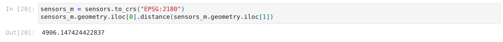


### Krok A6. Dzielnice

Wczytaj dzielnice przez `gpd.read_file`, przelicz do EPSG:2180 i dodaj kolumnę `area_km2 = area / 1e6`. Powinno wyjść 29 dzielnic i 148,8 km² łącznie. Największe są Czarnowąsy (14,1 km²), najmniejsze Borki (0,66 km²). Na koniec narysuj mapę przez `.plot()`.

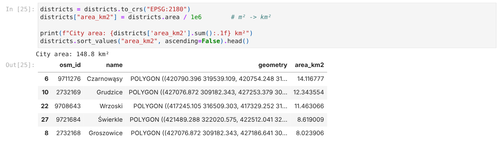
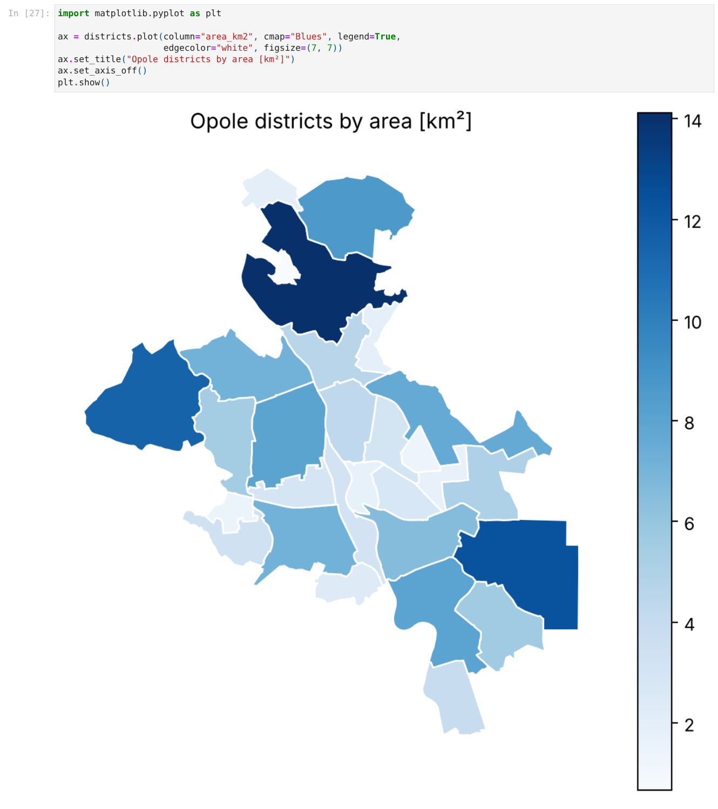

### Krok A7. Złączenie przestrzenne

Przypisz czujniki do dzielnic przez `gpd.sjoin(..., predicate="within")`, policz średnie PM2.5 przez `groupby` i odfiltruj dzielnice z mniej niż 3 czujnikami. Wynik: Stare Miasto 29,6, Śródmieście 26,8, Zaodrze 22,5 µg/m³. Trzy dzielnice nie mają żadnego czujnika.


### Krok A8. Bufory wokół szkół

Wczytaj szkoły, przelicz do EPSG:2180, zrób `buffer(500)` i znów użyj `sjoin`. Wynik: 11 z 19 szkół ma czujnik w promieniu 500 m, a średnie PM2.5 przy nich to 22,3 µg/m³. Pokrycie miasta policz przez `union_all()` i `intersection()`: wychodzi ok. 9,5%.


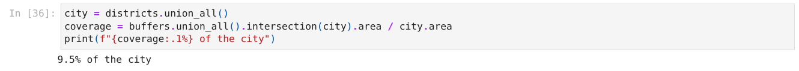


### Krok A9. Zapis

Zapisz wyniki do GeoPackage (`to_file(..., layer=..., driver="GPKG")`) i do GeoJSON w EPSG:4326. Potem sprawdź warstwy przez `gpd.list_layers` i wczytaj plik z powrotem: powinno być 29 wierszy w EPSG:2180.

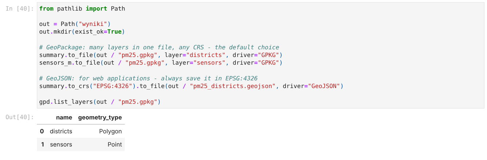


## Część B – Rasterio

### Krok B1. Otwarcie rastra i metadane

Otwórz pasmo B04 przez `rasterio.open` i wypisz `crs`, `transform`, `bounds`, `res`, `nodata` i `dtypes`. Rastry mają 1995 × 1426 px, float32 i EPSG:4326, bez nodata. Sprawdź też, czy B04 i B08 mają tę samą siatkę, i przelicz rozmiar piksela na metry (ok. 6,3 m).


### Krok B2. Piksel ↔ współrzędne

Użyj `src.index(lon, lat)`, żeby dostać wiersz i kolumnę, oraz `src.xy(row, col)`, żeby dostać współrzędne środka piksela. Dla Rynku wychodzi piksel (671, 960) i NDVI ok. 0,07.

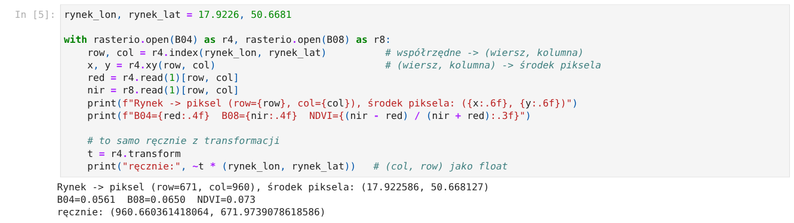

### Krok B3. Odczyt pasm i histogramy

Wczytaj oba pasma przez `read(1)`, policz min, max i średnią, a potem narysuj pasma i histogram.

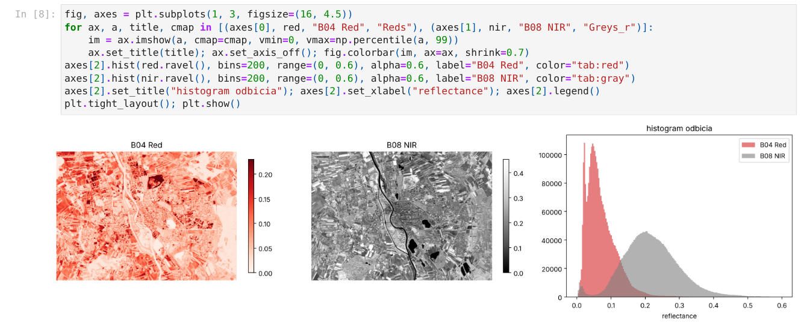

### Krok B4. Reprojekcja do EPSG:2180

Policz nową siatkę przez `calculate_default_transform(..., resolution=10)` i przelicz oba pasma przez `reproject` z `dst_nodata=np.nan` i `Resampling.bilinear`. Ok. 3% pikseli wychodzi NaN, bo to rogi nowej siatki.

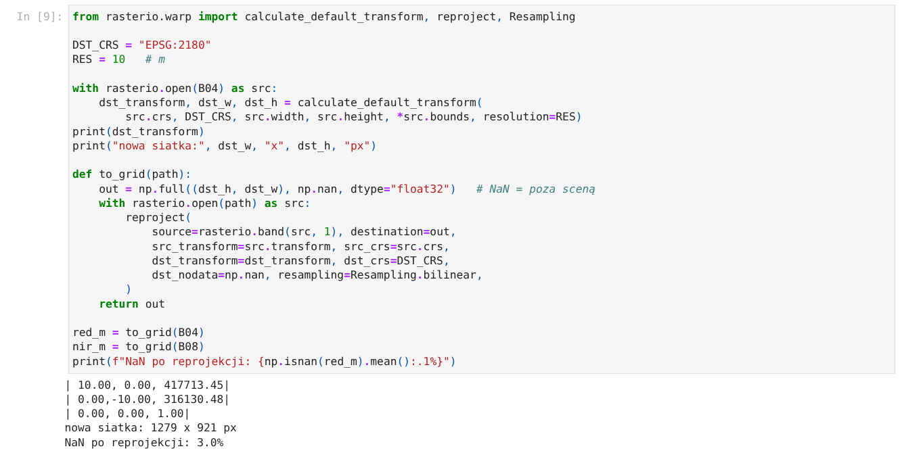

### Krok B5. NDVI

Policz NDVI = (B08 - B04) / (B08 + B04) wewnątrz `np.errstate(divide="ignore", invalid="ignore")`. Średnia wychodzi ok. 0,49.


### Krok B6. Klasyfikacja i hektary

Podziel NDVI na klasy przez `np.digitize` (progi 0, 0,2 i 0,5) i policz powierzchnię jako liczbę pikseli × 0,01 ha.

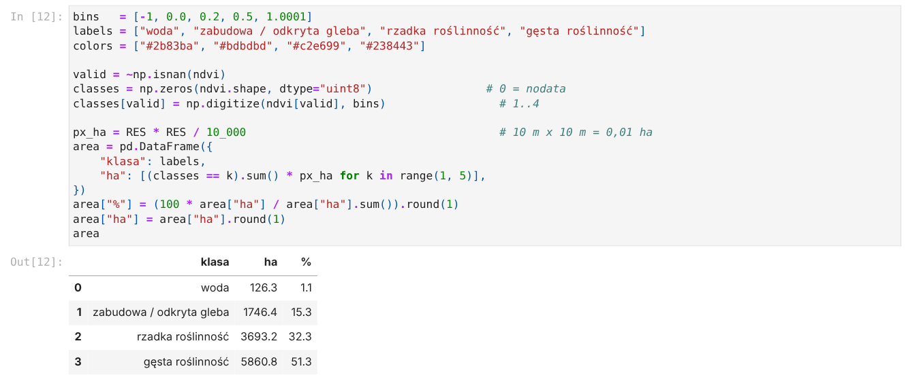

### Krok B7. Statystyki dla dzielnic

Dla każdej dzielnicy wytnij piksele przez `rasterio.mask.mask(..., crop=True)` i policz średnie NDVI oraz pokrycie. Zdjęcie nie obejmuje północy miasta, więc w rankingu zostaw tylko dzielnice pokryte w co najmniej 90%. Najwięcej zieleni ma Nadodrze (0,66), najmniej Stare Miasto (0,36).


### Krok B8. Zapis GeoTIFF

Zapisz NDVI przez `rasterio.open(..., "w", **profile)` z `crs="EPSG:2180"`, `nodata=np.nan` i `compress="deflate"`, a potem wczytaj plik z powrotem i porównaj z tablicą w pamięci.

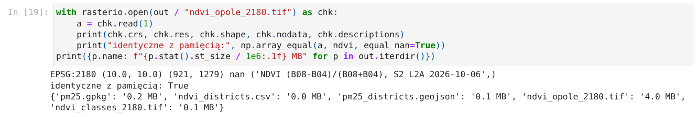

## Krok końcowy. Aplikacja Streamlit (opcjonalnie)

Obie analizy są też w `app.py`. Uruchamia się ją komendą:

```
streamlit run app.py
```

## Wnioski

Najgorsze powietrze i najmniej zieleni są w centrum (Stare Miasto, Śródmieście), a najwięcej zieleni ma Nadodrze. Odległości, powierzchnie i bufory trzeba liczyć w układzie metrycznym (EPSG:2180). Dane przed analizą trzeba przejrzeć i oczyścić.
